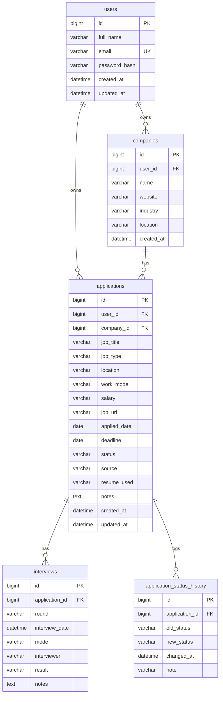
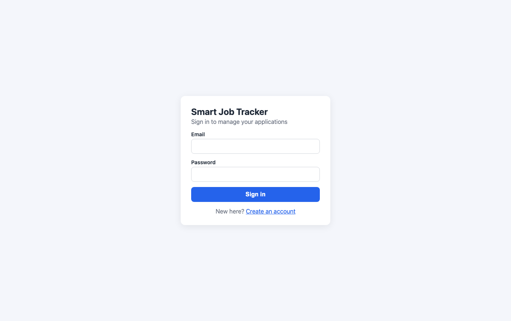
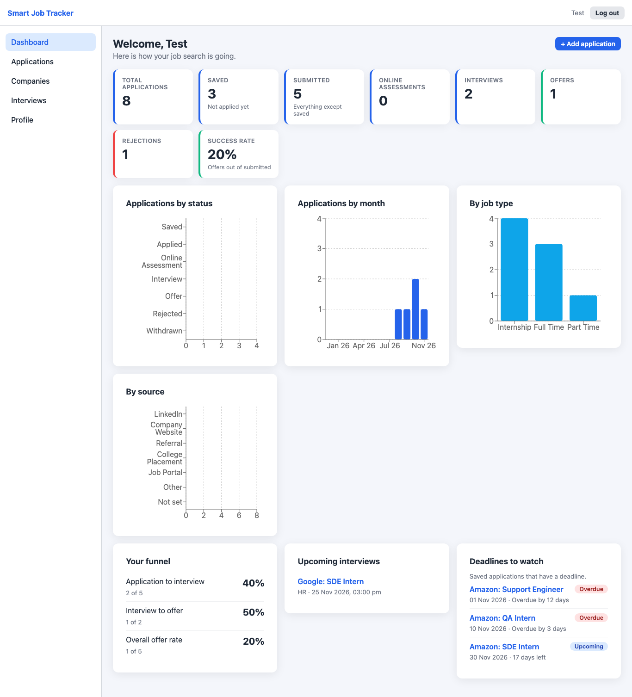
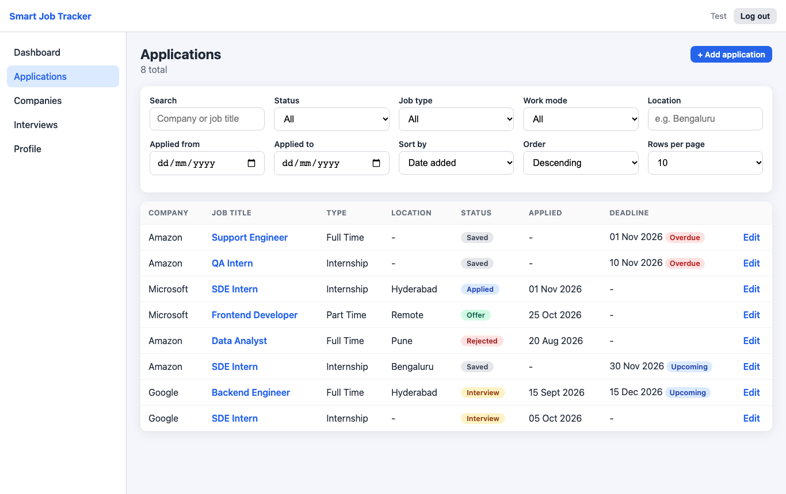
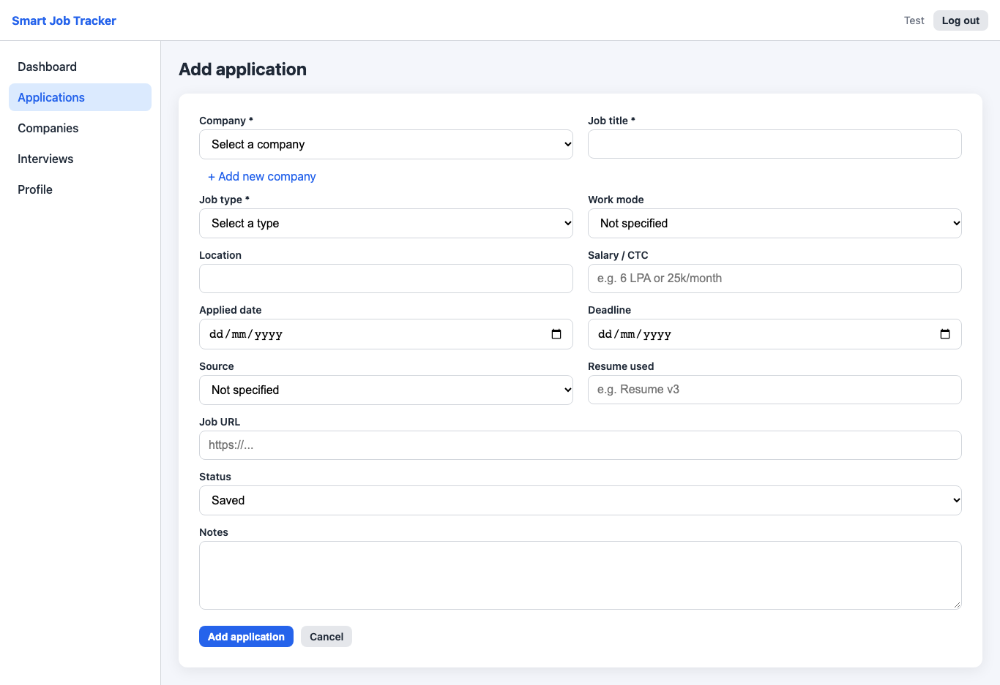
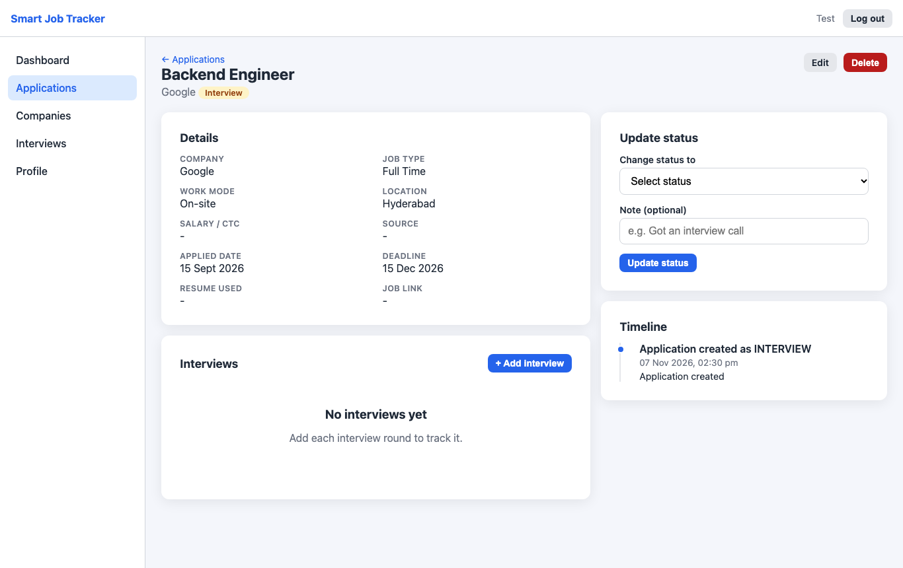
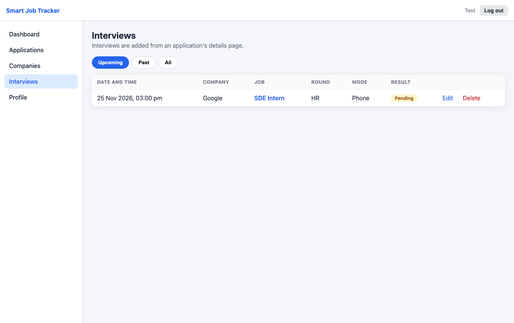

# Smart Job Tracker

A full-stack web application for students and job seekers to track job and internship applications, interview rounds and deadlines, and to see where their job search stands.

## Problem statement

A job search quickly spreads across LinkedIn, company portals, campus placement drives and referrals. A spreadsheet can store the rows, but it cannot tell you which deadline is overdue, which stage an application reached, or what share of your applications turn into interviews and offers.

Smart Job Tracker keeps one private record per user: every application, every status change and every interview round, with a dashboard computed from that stored data.

## Features

**Authentication and security**
- Registration and login with BCrypt-hashed passwords and stateless JWT authentication
- Every API route except `/api/auth/**` requires a valid token
- A user can only read and change their own data: queries are scoped by the user id taken from the token, never from the request body

**Applications**
- Create, view, edit and delete applications (company, title, job type, work mode, location, salary, job URL, applied date, deadline, source, resume used, notes)
- Controlled status workflow: Saved, Applied, Online Assessment, Interview, Offer, Rejected, Withdrawn
- Every status change is written to a history table, so the per-application timeline is built from real stored data
- Search (company, job title), filters (status, job type, work mode, location, date range), sorting and pagination, all executed in the database
- Deadline priority badge (Overdue, Due soon, Upcoming) on open applications
- Duplicate warning when the same role at the same company already exists

**Companies and interviews**
- Per-user company records (one company, many applications)
- Multiple interview rounds per application (round, date and time, mode, interviewer, result, notes)
- Interviews page with upcoming and past views

**Dashboard**
- Counts per status, number of submitted applications, success rate
- Funnel: application to interview, interview to offer, overall offer rate
- Saved applications with deadlines, classified as Overdue, Due soon or Upcoming
- Upcoming interviews
- Four charts: status, applications per month, job type, source

**Profile:** update name and email, change password.

## Tech stack

| Layer | Technology |
|---|---|
| Backend | Java 21, Spring Boot 4, Spring Web, Spring Data JPA (Hibernate), Spring Security, JWT (jjwt), Bean Validation, Flyway, Maven |
| Frontend | React (Vite), JavaScript, React Router, Axios, Recharts, plain responsive CSS |
| Database | MySQL |
| Testing | JUnit 5, Mockito, MockMvc, Spring Boot Test |
| Tools | Git and GitHub |

## Architecture

```
React SPA (Vite, port 5180)
   |  Axios, JWT in the Authorization header
   v
Spring Boot REST API (stateless, port 8080)
   JWT filter -> Controller -> Service -> Repository -> MySQL
```

- **Controllers** only handle HTTP (request, response, status codes). Business rules and ownership checks live in the **service** layer.
- **DTOs** are used for all requests and responses, so entities (and password hashes) never leave the service layer.
- A **global exception handler** turns every error into one JSON shape with a meaningful status code. Stack traces are never returned to the client.
- Authentication is **stateless**: no server session, so no `JSESSIONID` cookie. Logout means the client deletes the token.

## Database design

Five tables. The schema is managed by Flyway (`backend/src/main/resources/db/migration/V1__init_schema.sql`); Hibernate only validates it (`ddl-auto=validate`).



| Table | Purpose | Key constraints |
|---|---|---|
| `users` | Accounts | `UNIQUE (email)` |
| `companies` | Per-user companies | `UNIQUE (user_id, name)`, FK to users |
| `applications` | Job applications | FKs to users and companies, `CHECK` on enum columns |
| `interviews` | Interview rounds | FK to applications, `ON DELETE CASCADE` |
| `application_status_history` | Append-only status log | FK to applications, `ON DELETE CASCADE` |

**Design decisions**
- **Normalization (3NF):** company details are stored once; interviews and status history are separate tables because one application has many of each.
- **Deliberate denormalization:** `applications.status` mirrors the latest history row so lists, filters and dashboard counts do not have to recompute it. Both are written inside one `@Transactional` method, so they cannot drift apart.
- `applications.user_id` is stored directly, so an ownership check and every filter is one indexed condition.
- Enum columns are `VARCHAR` with `CHECK` constraints, plus Java enums in the application. Adding a value is a small migration.
- Companies are per user, so users can never see or edit each other's data.
- A company that still has applications cannot be deleted (the API returns 409 instead of a raw database error).

**Indexes:** `users(email)` unique; `companies(user_id, name)` unique; `applications(user_id, status)`, `applications(user_id, deadline)`, `applications(user_id, applied_date)`; `interviews(interview_date)`; `application_status_history(application_id, changed_at)`. MySQL creates the foreign key indexes automatically.

## API

Base URL: `http://localhost:8080/api`. Every endpoint except register and login needs the header `Authorization: Bearer <token>`.

All errors use one shape:

```json
{
  "timestamp": "2026-11-12T10:15:37",
  "status": 400,
  "error": "Bad Request",
  "message": "Validation failed",
  "path": "/api/auth/register",
  "fieldErrors": { "email": "Email format is invalid" }
}
```

| Status | Meaning |
|---|---|
| 400 | Validation failed or invalid input (`fieldErrors` lists the fields) |
| 401 | Missing, invalid or expired token, or wrong login credentials |
| 404 | Not found. Also returned for another user's data, so ids cannot be probed |
| 409 | Conflict: duplicate email or company name, or deleting a company that still has applications |

### Authentication and profile

| Method | Endpoint | Purpose |
|---|---|---|
| POST | `/auth/register` | Create account, returns token and user |
| POST | `/auth/login` | Log in, returns token and user |
| GET | `/users/me` | Current user |
| PUT | `/users/me` | Update name and email (returns a fresh token, because the token subject is the email) |
| PUT | `/users/me/password` | Change password |

### Companies

| Method | Endpoint | Purpose |
|---|---|---|
| GET | `/companies?search=` | List own companies |
| POST | `/companies` | Create |
| GET | `/companies/{id}` | Get one |
| PUT | `/companies/{id}` | Update |
| DELETE | `/companies/{id}` | Delete (409 if it has applications) |

### Applications

| Method | Endpoint | Purpose |
|---|---|---|
| GET | `/applications` | Paged list. Query: `search`, `status`, `jobType`, `workMode`, `location`, `from`, `to`, `sortBy`, `sortDir`, `page`, `size` |
| POST | `/applications` | Create (a new application starts as `SAVED` unless a status is given) |
| GET | `/applications/{id}` | Get one (includes `deadlinePriority` and `daysLeft` for open applications) |
| PUT | `/applications/{id}` | Update fields (does not change the status) |
| PATCH | `/applications/{id}/status` | Change status; writes a history row in the same transaction |
| DELETE | `/applications/{id}` | Delete (history and interviews are removed by `ON DELETE CASCADE`) |
| GET | `/applications/{id}/timeline` | Status history and interviews merged in time order |
| GET | `/applications/duplicates?companyId=&jobTitle=` | Possible duplicates (same company and title, ignoring case and extra spaces) |

`sortBy` accepts `appliedDate`, `deadline`, `company`, `status`, `createdAt` (a whitelist). `size` is 1 to 50.

### Interviews

| Method | Endpoint | Purpose |
|---|---|---|
| GET | `/applications/{applicationId}/interviews` | Rounds of one application |
| POST | `/applications/{applicationId}/interviews` | Add a round |
| PUT | `/interviews/{id}` | Update a round |
| DELETE | `/interviews/{id}` | Delete a round |
| GET | `/interviews` | All own interviews, newest first |
| GET | `/interviews/upcoming?limit=` | Pending interviews in the future, nearest first |

### Dashboard

| Method | Endpoint | Purpose |
|---|---|---|
| GET | `/dashboard/summary` | Counts, success rate, upcoming deadlines (with priority) and upcoming interviews |
| GET | `/dashboard/status-distribution` | Count per status |
| GET | `/dashboard/monthly-applications` | Last 12 months |
| GET | `/dashboard/by-job-type` | Count per job type |
| GET | `/dashboard/by-source` | Count per source |
| GET | `/dashboard/funnel` | Interview and offer rates, computed from status history |

## Smart features

All of these are plain, explainable logic. There is no AI or machine learning in this project.

- **Deadline priority:** a deadline is Overdue (already passed), Due soon (within 7 days), Upcoming, or No deadline. It applies to open applications (not Offer, Rejected or Withdrawn), so a finished application is never "overdue". The dashboard lists saved applications that have a deadline.
- **Funnel analytics:** the interview and offer counts come from the status history table, so an application that reached Interview and was rejected later still counts as interviewed. Rates guard against division by zero.
- **Duplicate warning:** a warning, not a block, because applying to the same role twice is sometimes valid.

## Getting started

### Prerequisites

Java 21, Node.js 20.19 or newer, MySQL 8 or newer, Git. Maven is not needed separately (the Maven Wrapper `./mvnw` is included).

### 1. Database

```sql
CREATE DATABASE job_tracker CHARACTER SET utf8mb4 COLLATE utf8mb4_unicode_ci;
CREATE DATABASE job_tracker_test CHARACTER SET utf8mb4 COLLATE utf8mb4_unicode_ci;
CREATE USER 'jobtracker'@'localhost' IDENTIFIED BY 'choose-a-password';
GRANT ALL PRIVILEGES ON job_tracker.* TO 'jobtracker'@'localhost';
GRANT ALL PRIVILEGES ON job_tracker_test.* TO 'jobtracker'@'localhost';
```

`job_tracker_test` is used only by the automated tests. Tables are created automatically by Flyway on the first start.

### 2. Environment variables

Secrets are never stored in the code. See `backend/.env.example`.

| Variable | Required | Meaning |
|---|---|---|
| `DB_PASSWORD` | yes | Password of the MySQL user `jobtracker` |
| `JWT_SECRET` | yes | Base64 secret for signing tokens |
| `DB_URL` | no | Default `jdbc:mysql://localhost:3306/job_tracker` |
| `DB_USERNAME` | no | Default `jobtracker` |
| `VITE_API_URL` | no (frontend) | Default `http://localhost:8080/api` |

```bash
echo 'export DB_PASSWORD="your-mysql-password"' >> ~/.zshrc
echo "export JWT_SECRET=\"$(openssl rand -base64 48)\"" >> ~/.zshrc
source ~/.zshrc
```

The allowed frontend origin for CORS is `app.cors.allowed-origins` in `application.properties` (default `http://localhost:5180`).

### 3. Run the backend

```bash
cd backend
./mvnw spring-boot:run
```

The API starts on `http://localhost:8080`. Health check: `http://localhost:8080/actuator/health`.

### 4. Run the frontend

```bash
cd frontend
npm install
npm run dev
```

Open `http://localhost:5180`.

## Testing

```bash
cd backend
./mvnw clean test
```

39 automated tests:
- **Unit tests (Mockito):** authentication and company services, deadline priority rules (including the boundary days)
- **Integration tests (MockMvc and a real MySQL test database):** registration, duplicate registration, login, invalid login, creating, updating and deleting applications, status history, interviews, dashboard statistics, profile and password change, duplicate lookup, and ownership checks (another user gets 404 on every operation)

Frontend checks: `npm run lint` and `npm run build`.

## Screenshots

| | |
|---|---|
|  |  |
|  |  |
|  |  |

## Project structure

```
smart-job-tracker/
├── backend/
│   ├── pom.xml
│   └── src/
│       ├── main/java/com/jobtracker/
│       │   ├── config/        security and CORS configuration
│       │   ├── controller/    REST controllers
│       │   ├── dto/           request and response objects
│       │   ├── entity/        JPA entities and enums
│       │   ├── exception/     custom exceptions and the global handler
│       │   ├── repository/    Spring Data repositories and specifications
│       │   ├── security/      JWT utility, filter, user details service
│       │   ├── service/       business logic and ownership checks
│       │   └── util/          deadline priority
│       ├── main/resources/db/migration/   Flyway migrations
│       └── test/              unit and integration tests
└── frontend/
    └── src/
        ├── api/               Axios client and API modules
        ├── components/        common, layout, applications, companies, interviews, dashboard, profile
        ├── context/           authentication state
        ├── hooks/             useAuth, useDebounce
        ├── pages/             one component per route
        └── utils/             constants, formatting, form helpers
```

## Known limitations

- **Logout is client-side.** JWTs are stateless, so a token stays valid until it expires (24 hours). A token blacklist or refresh tokens would fix this.
- **The token is kept in `localStorage`,** which is simple but exposed to XSS. An httpOnly cookie would avoid that but needs CSRF protection.
- **Timeline order:** a history row is stamped when the change is recorded in the tracker, not on the real-world date, so an old interview can appear before the "application created" entry.
- **Funnel:** an application created directly with an advanced status (for example Offer) counts as an offer without having passed through Interview.
- **Duplicate check is not atomic:** two tabs submitting at the same moment can both pass the check. A hard rule would need a database constraint.
- Changing the password does not invalidate tokens that were already issued.

## Future enhancements

- Kanban board grouped by status
- Keyword matching between a job description and the user's skills (simple and transparent)
- Refresh tokens and token revocation
- CSV export of applications
- Docker Compose for MySQL and the backend
- Deployment (backend and frontend)
- OpenAPI / Swagger documentation
- Frontend component tests
